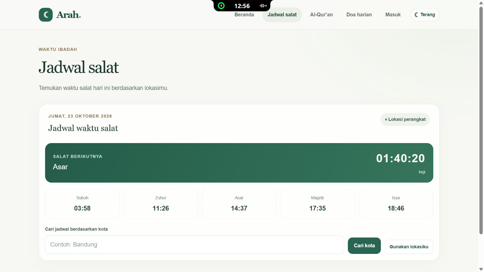
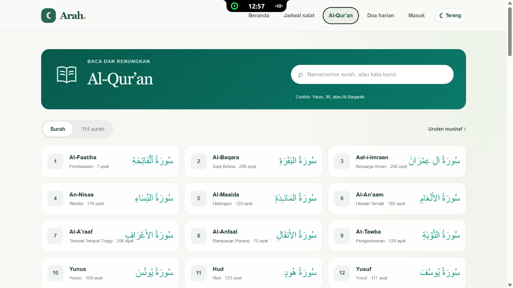
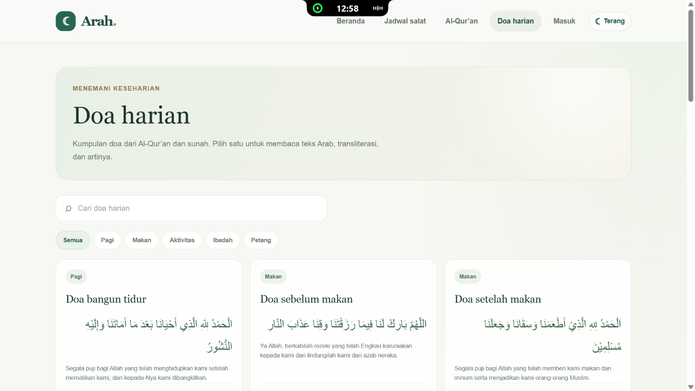
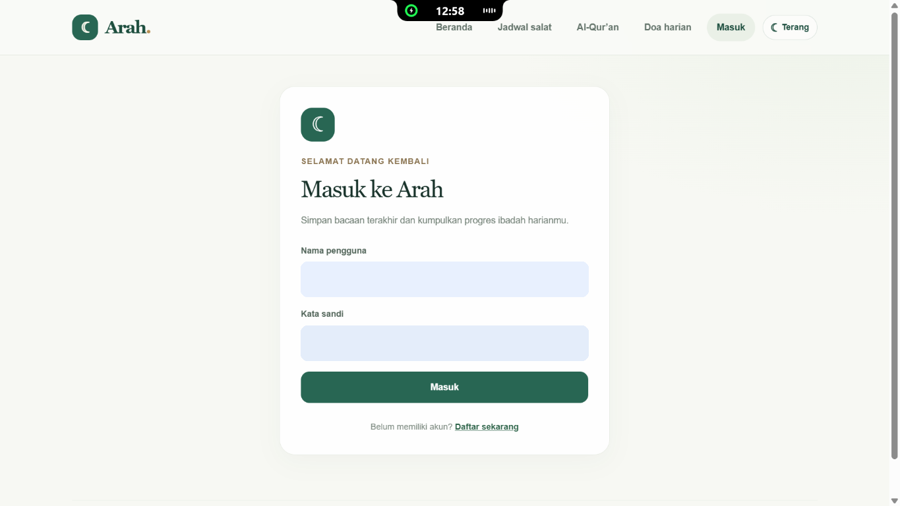
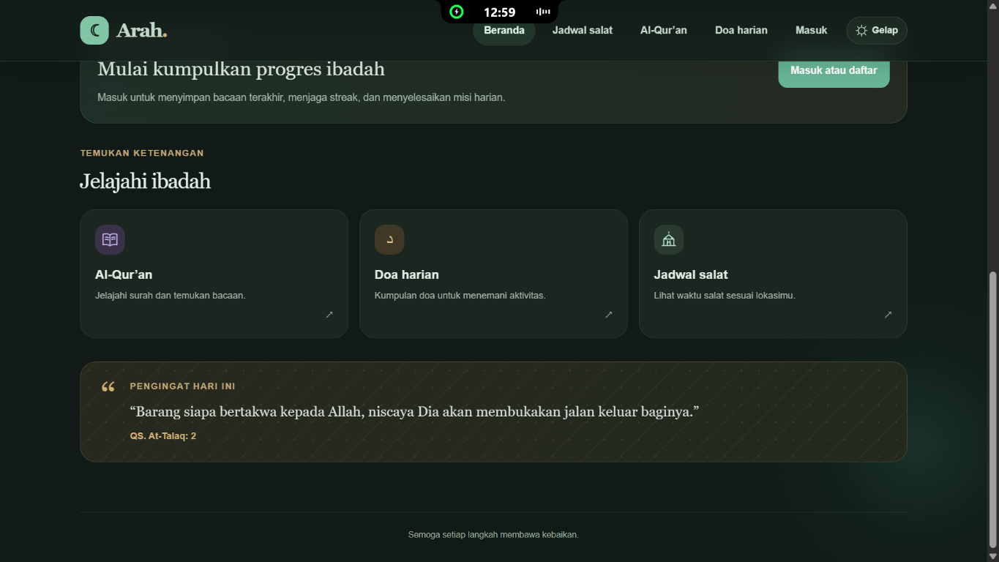
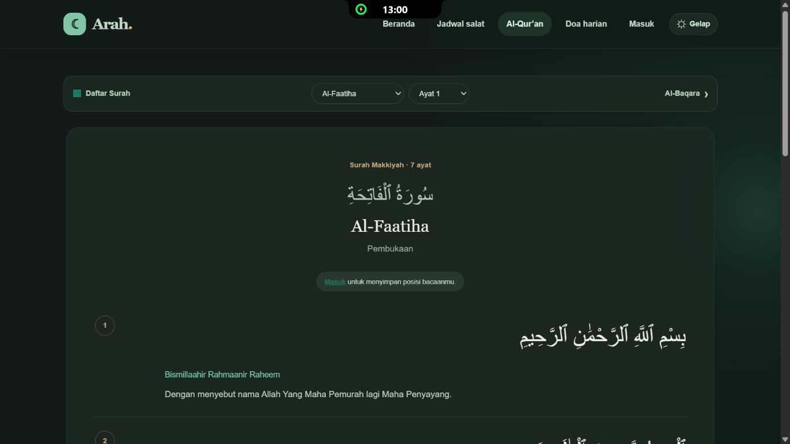
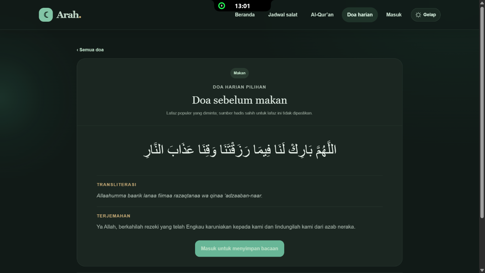
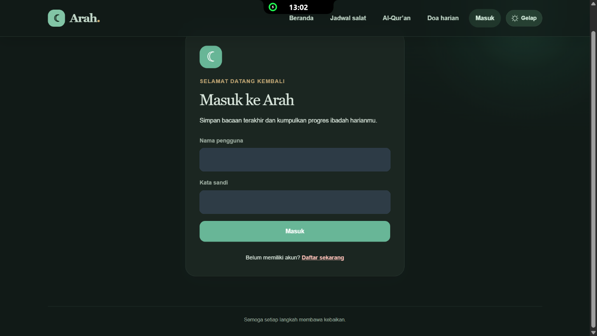

# Arah — Aplikasi Islami

Arah adalah prototipe aplikasi web Islami untuk membantu pengguna melihat jadwal salat, membaca Al-Qur’an, menemukan doa harian, dan menyimpan progres ibadah. Antarmuka responsif dibuat dengan Next.js; fitur akun dan progres didukung API NestJS serta MySQL.

**Deploy:** [prototype-aplikasi-islami.vercel.app](https://prototype-aplikasi-islami.vercel.app/)

> Situs deploy menyajikan frontend. Fitur akun, progres, dan bookmark memerlukan backend API yang dapat dijangkau serta database MySQL yang telah dikonfigurasi. Lihat [Konfigurasi deployment](#konfigurasi-deployment).

## Fitur

- **Beranda dashboard** dengan sapaan akun, jadwal salat ringkas, hitung mundur waktu salat berikutnya, pengingat harian, dan ringkasan progres.
- **Jadwal salat** berdasarkan lokasi perangkat atau kota, beserta pilihan waktu salat berikutnya.
- **Al-Qur’an** dengan katalog 114 surah, pencarian, halaman baca per surah, ayat Arab, transliterasi, terjemahan, dan navigasi ayat.
- **Doa harian** dengan 24 doa, pencarian, kategori, serta halaman detail berisi teks Arab, transliterasi, terjemahan, dan keterangan sumber.
- **Akun pengguna** dengan registrasi dan login memakai nama pengguna serta kata sandi. Kata sandi disimpan sebagai hash; sesi menggunakan cookie HTTP-only.
- **Progres ibadah per akun:** streak login, misi harian, poin, dan bacaan terakhir Al-Qur’an/doa.
- **Bookmark pribadi** untuk ayat dan doa. Koleksi memiliki kategori Al-Qur’an dan Doa, serta kategori kustom yang dapat dibuat pengguna.
- **Tema terang dan gelap**, preferensi tema tersimpan di browser, efek glow kursor sederhana pada tema gelap, dan transisi antartema.
- **Antarmuka responsif** dengan header acrylic, animasi ringan, dan dukungan preferensi reduced motion.

## Tampilan

Screenshot berikut memperlihatkan contoh halaman pada tema terang dan gelap. Nilai akun pada screenshot login telah disamarkan.

### Tema terang

| Jadwal salat | Katalog Al-Qur’an |
|---|---|
|  |  |

| Doa harian | Halaman masuk |
|---|---|
|  |  |

### Tema gelap

| Beranda | Pembaca Al-Qur’an |
|---|---|
|  |  |

| Detail doa | Halaman masuk |
|---|---|
|  |  |

Gunakan tombol tema di header untuk berpindah antara **Terang** dan **Gelap**. Pilihan disimpan pada browser yang digunakan. Tema gelap menyesuaikan latar, kartu, navigasi, dan teks agar nyaman dibaca; efek glow kursor hanya aktif pada perangkat dengan pointer yang sesuai dan tidak aktif jika reduced motion dipilih.

## Teknologi

- **Frontend:** Next.js, React, TypeScript, CSS.
- **Backend:** NestJS, TypeScript, JWT, `class-validator`.
- **Database:** MySQL-compatible, termasuk Aiven MySQL.
- **Data eksternal:** AlQuran Cloud API untuk katalog dan bacaan Al-Qur’an; Aladhan API untuk jadwal salat.
- **Hosting:** frontend di Vercel, backend di Railway atau Render.

## Menjalankan secara lokal

### Persyaratan

- Node.js **20.19 atau lebih baru** dan npm.
- MySQL 8 atau layanan MySQL-compatible yang bisa dijangkau backend.
- Sertifikat CA database apabila provider mewajibkan TLS, misalnya Aiven.

### 1. Siapkan database

Pilih database untuk aplikasi, misalnya `islami_app` pada MySQL lokal atau database `defaultdb` yang disediakan layanan cloud. Jalankan [`database/schema.sql`](database/schema.sql) **pada database yang sudah dipilih** untuk instalasi baru. File tersebut tidak memilih nama database secara otomatis.

Untuk instalasi lama yang masih memakai skema blueprint, jalankan migrasi berikut satu kali dan berurutan:

1. [`database/migrations/001-user-accounts-reading-progress.sql`](database/migrations/001-user-accounts-reading-progress.sql)
2. [`database/migrations/002-user-bookmarks.sql`](database/migrations/002-user-bookmarks.sql)

Migrasi pertama menghapus kolom kata sandi lama yang mungkin menyimpan teks biasa. Akun lama perlu mendaftar kembali dengan nama pengguna baru.

### 2. Konfigurasikan backend

Salin `backend/.env.example` ke `backend/.env`, lalu isi sesuai database yang dipakai. Contoh PowerShell:

```powershell
Copy-Item backend/.env.example backend/.env
```

Isi variabel berikut tanpa menyimpan rahasia ke Git:

```dotenv
PORT=3001
NODE_ENV=development
FRONTEND_ORIGIN=http://localhost:3000
DB_HOST=127.0.0.1
DB_PORT=3306
DB_USER=islami_app
DB_PASSWORD=<kata-sandi-database>
DB_NAME=islami_app
DB_SSL=false
DB_SSL_CA=./certs/ca.pem
DB_CONNECTION_LIMIT=10
JWT_SECRET=<rahasia-acak-minimal-32-karakter>
COOKIE_SAMESITE=lax
COOKIE_SECURE=false
```

Untuk database Aiven atau layanan lain yang memerlukan TLS:

- Atur `DB_SSL=true`.
- Unduh CA certificate dari penyedia database. `DB_SSL_CA` menerima path file, isi PEM, atau `base64:<isi-base64>`.
- Contoh lokal: simpan sebagai `backend/certs/ca.pem` dan atur `DB_SSL_CA=./certs/ca.pem`.
- Contoh hosting: atur `DB_SSL_CA=base64:<hasil base64 ca.pem>` agar tidak perlu mengunggah file.
- Backend memvalidasi sertifikat; jangan mematikan verifikasi TLS.
- Isi `DB_HOST`, `DB_PORT`, `DB_USER`, `DB_PASSWORD`, dan `DB_NAME` menggunakan kredensial privat database.

`backend/.env` dan `backend/certs/ca.pem` diabaikan Git. Jangan membagikan atau melakukan commit kata sandi, JWT secret, atau sertifikat privat.

### 3. Instal dependensi dan jalankan

Buka dua terminal dari direktori repository.

Terminal pertama — backend:

```powershell
cd backend
npm ci
npm run start:dev
```

Terminal kedua — frontend:

```powershell
cd frontend
npm ci
npm run dev
```

Buka [http://localhost:3000](http://localhost:3000). Backend berjalan pada `http://localhost:3001` dan harus berhasil terhubung ke database sebelum API akun siap.

Frontend mem-proxy `/api` ke backend melalui `BACKEND_URL` (default `http://127.0.0.1:3001`), sehingga tidak perlu mengatur `NEXT_PUBLIC_API_URL` untuk pengembangan lokal. Jika alamat backend berbeda, salin `frontend/.env.example` ke `frontend/.env.local`, atur `BACKEND_URL`, lalu jalankan ulang frontend.

## Konfigurasi deployment

Arsitektur yang dipakai:

- **Frontend** di Vercel.
- **Backend** di Railway atau Render sebagai proses Node biasa.
- **Database** MySQL Aiven.
- Browser memanggil `/api/*` pada domain frontend, lalu Vercel meneruskannya ke backend. Dengan proxy ini cookie sesi tetap first-party dan CORS tidak diperlukan.

### 1. Siapkan database Aiven

1. Buat layanan MySQL di Aiven, lalu catat host, port, user, password, dan nama database (`defaultdb`).
2. Unduh CA certificate dari halaman koneksi Aiven.
3. Jalankan [`database/schema.sql`](database/schema.sql) pada database tersebut (`DB_NAME=defaultdb` untuk database bawaan Aiven). Contoh:

   ```bash
   mysql --host=<host> --port=<port> --user=<user> --password \
     --ssl-mode=VERIFY_CA --ssl-ca=ca.pem defaultdb < database/schema.sql
   ```

   Skema memuat tabel akun, progres, bookmark, dan seed misi harian. Jangan jalankan ulang pada database yang sudah berisi tabel; untuk skema lama gunakan migrasi di `database/migrations/`.
4. Simpan CA certificate untuk environment backend.

### 2. Deploy backend ke Railway

1. Buat project Railway dari repository ini dan set **Root Directory** ke `backend`.
2. Railway membaca [`backend/railway.json`](backend/railway.json): build `npm ci --include=dev && npm run build`, start `npm run start:prod`, health check `/api`.
3. Atur environment berikut:

   | Variabel | Nilai |
   |---|---|
   | `NODE_ENV` | `production` |
   | `FRONTEND_ORIGIN` | `https://<domain-vercel>` |
   | `DB_HOST`, `DB_PORT`, `DB_USER`, `DB_PASSWORD`, `DB_NAME` | kredensial Aiven |
   | `DB_SSL` | `true` |
   | `DB_SSL_CA` | `base64:<isi-base64 ca.pem>` atau isi PEM |
   | `DB_CONNECTION_LIMIT` | `5` |
   | `JWT_SECRET` | rahasia acak minimal 32 karakter |
   | `COOKIE_SAMESITE` | `lax` untuk mode proxy |
   | `COOKIE_SECURE` | `true` |

   `PORT` diisi otomatis oleh Railway. Untuk membuat nilai base64 CA di PowerShell:

   ```powershell
   [Convert]::ToBase64String([IO.File]::ReadAllBytes("ca.pem"))
   ```

   Lalu set `DB_SSL_CA=base64:<hasil-perintah-di-atas>`.

4. Deploy, lalu pastikan `https://<domain-backend>/api` mengembalikan teks `Backend Aplikasi Islami berjalan`.
5. Untuk Render, gunakan [`render.yaml`](render.yaml) sebagai Blueprint; isi environment rahasia saat diminta.

### 3. Deploy frontend ke Vercel

1. Import repository ini di Vercel dan set **Root Directory** ke `frontend`.
2. Tambahkan environment `BACKEND_URL=https://<domain-backend>` (tanpa akhiran `/api`).
3. Deploy. Biarkan `NEXT_PUBLIC_API_URL` kosong agar frontend memakai proxy `/api`. Jika domain backend berubah, perbarui `BACKEND_URL` lalu redeploy frontend karena rewrite dibaca saat build.
4. Setelah domain Vercel diketahui, perbarui `FRONTEND_ORIGIN` di backend dan redeploy backend.

### 4. Verifikasi

- Buka situs, daftar akun, lalu refresh halaman untuk memastikan sesi tetap masuk.
- Simpan bookmark, buka surah/doa, dan cek progres pada beranda.
- Jika login gagal, periksa `FRONTEND_ORIGIN`, atribut cookie, dan CA certificate Aiven.

### Catatan produksi

- Jangan commit `.env`, password database, JWT secret, atau CA certificate. Simpan semuanya di dashboard hosting.
- Gunakan `JWT_SECRET` produksi yang berbeda dari lokal.
- Kecilkan `DB_CONNECTION_LIMIT` (misalnya `5`) agar tidak melewati batas koneksi Aiven.
- Mode proxy adalah pilihan yang disarankan. Jika frontend memanggil backend secara langsung, set `COOKIE_SAMESITE=none`, `COOKIE_SECURE=true`, dan pastikan `FRONTEND_ORIGIN` cocok; sebagian browser tetap dapat memblokir cookie pihak ketiga.
- `FRONTEND_ORIGIN` menerima beberapa origin dipisahkan koma, misalnya domain produksi dan preview Vercel. Tulis origin secara lengkap dengan `https://` dan tanpa garis miring di akhir.

Tautan frontend saja tidak mengaktifkan layanan akun apabila backend atau database belum dideploy dan dikonfigurasi.

## Pemeriksaan

Jalankan perintah dari folder masing-masing.

Frontend:

```powershell
npm run lint
npx tsc --noEmit
npm run build
```

Backend:

```powershell
npm run typecheck
npm run build
```

## Catatan data

Teks dan terjemahan ayat dimuat dari AlQuran Cloud; jadwal salat dihitung menggunakan Aladhan. Doa harian merupakan data lokal di `frontend/src/data/dailyDuas.ts`; periksa keterangan sumber pada tiap doa. Ketersediaan layanan eksternal memerlukan koneksi internet.
